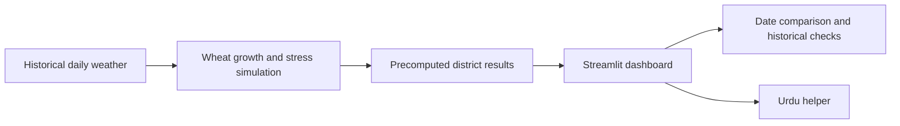

# SowSmart

**Climate-smart wheat sowing guidance, grounded in local weather history and built for the people who grow Pakistan's food.**

SowSmart is a prototype that helps farmers and agricultural advisors compare wheat sowing dates across eight districts in Punjab and Sindh. Pick a district and a date to explore simulated heat stress, historical patterns, and a safer sowing window.

> **Hackathon demo:** [Video demo](ADD_VIDEO_URL) · [Pitch deck](ADD_PPT_URL) · [Project documentation](ADD_DOCUMENTATION_URL)

## The Problem

Wheat planted later in the season can reach grain filling during hotter weather.

**The timing trap:** Farmers may have to **delay sowing** while another crop is still in the field, but a single calendar date cannot show how that choice changes **heat exposure**.

**The local gap:** A one-size-fits-all calendar misses how weather risk differs between districts, while climate variability makes fixed dates less dependable.

## The Solution

SowSmart replays historical weather seasons against candidate sowing dates. A crop-growth simulator estimates when wheat would mature and tallies a transparent stress score; the dashboard turns those results into a district-level comparison farmers and advisors can explore.

1. **Choose a district and sowing date.** The current dashboard covers Faisalabad, Multan, Bahawalpur, Rahim Yar Khan, Sargodha, Sahiwal, Larkana, and Hyderabad.
2. **Compare simulated risk.** See the historically safer window, the best-scoring date, and how the selected date compares.
3. **Explore the evidence.** Review the 2022 heat check, long-term sowing-date drift, and an earlier/later date comparison.
4. **Use the result as a conversation starter.** The repository includes an Urdu and Roman Urdu helper, with offline response and optional language-model support.

The research pipeline also supports per-year recommendations, warming scenarios, sensitivity analysis, and comparisons with district yield data. These research outputs are distinct from the dashboard's precomputed input files.

### How It Works



## What Makes It Useful

- **Local comparisons:** district-level results instead of one national sowing calendar.
- **What-if exploration:** compare candidate dates, not only a fixed recommendation.
- **Climate context:** inspect historical drift and test warming scenarios in the research pipeline.
- **Honest uncertainty:** the interface warns users about fake data and states what the model cannot conclude.

### AI-Powered Local Accessibility

The repository includes an Urdu and Roman Urdu helper with offline, fact-based responses and optional Anthropic, Gemini, or Groq language-model support to explain local results conversationally. The helper is implemented separately from the root dashboard and needs integration before it can be presented as live dashboard Q&A.

## Tech Stack

| Area | Tools |
| --- | --- |
| Language | Python 3.10+ |
| Interactive dashboard | Streamlit |
| Data processing and simulation | pandas, NumPy |
| Statistics and trend analysis | SciPy |
| Dashboard charts and maps | Plotly, Streamlit charts |
| Research charts | Matplotlib |
| Weather data and API access | Open-Meteo Archive, Forecast, and Seasonal APIs; `requests` |
| Language-model integrations | Optional Anthropic, Gemini, or Groq API support in the Urdu helper |
| Data formats | CSV and JSON |

## Challenges & Accomplishments

| Challenge | What the project does |
| --- | --- |
| Turning daily weather into crop-stage risk | Uses growing degree days to estimate crop progress, then evaluates heat, frost, and late maturity across candidate sowing dates. |
| Making recommendations local and testable | Processes eight districts, checks a notable 2022 season, and includes long-term trends, warming scenarios, sensitivity runs, and yield-validation utilities. |
| Making a technical tool approachable without overstating certainty | Provides an interactive map and date comparison, an Urdu helper implementation, clear data warnings, and explicit limits on interpretation. |

## Project Structure

```text
.
|-- app.py                  # Streamlit dashboard
|-- results.json            # Dashboard's precomputed district results
|-- results_mock.json       # Clearly marked demo/fallback data
|-- config.py               # Model settings, district windows, and assumptions
|-- sowing_model.py         # Season-specific simulation and research routines
|-- advisor.py               # Batch analysis and research-output generation
|-- fetch_forecast.py       # Open-Meteo forecast snapshot downloader
|-- forecast_check.py       # Seasonal forecast versus history diagnostics
|-- forecasts/              # Saved forecast snapshots and comparison data
|-- wheat-advisor/
|   |-- advisor.py           # Urdu helper implementation
|   |-- sim_core.py          # Historical-weather simulator used by the legacy pipeline
|   |-- fetch_weather.py     # Download historical district weather
|   |-- cache/               # Cached daily weather CSVs
|   |-- data/                # Yield data and derived features
|   |-- results/             # Per-district research outputs
|   `-- docs/                # Calibration and sensitivity notes
|-- GuidesB/                 # Hackathon build guides
|-- slides/screens/          # Presentation screenshots
`-- test_urdu.py             # Offline Urdu-helper checks
```

## How to Run Locally

The dashboard uses the root-level `results.json` (or `results_mock.json` fallback). **No API key or weather download is needed to start the dashboard.** Commands are provided for Windows PowerShell and macOS/Linux shells.

1. Install Python 3.10 or newer and open a terminal in the project folder.
2. Create and activate an isolated environment:

   ```powershell
   python --version
   python -m venv .venv
   .\.venv\Scripts\Activate.ps1
   ```

   On macOS or Linux, use Bash or a compatible shell:

   ```bash
   python3 --version
   python3 -m venv .venv
   source .venv/bin/activate
   ```

3. Install the project dependencies:

   ```powershell
   python -m pip install --upgrade pip
   python -m pip install -r requirements.txt
   ```

4. Start the dashboard:

   ```powershell
   python -m streamlit run app.py
   ```

5. Open the local URL printed in the terminal, usually `http://localhost:8501`.

If PowerShell blocks environment activation, run the app with the environment's executable directly: `\.venv\Scripts\python.exe -m streamlit run app.py`.

### Optional Checks and Research

Run the offline Urdu-helper checks from the repository root:

```powershell
python test_urdu.py simple
```

The research pipeline can download historical weather (requires internet access) and generate district summaries. The command below uses the `wheat-advisor` dependency set:

```powershell
python -m pip install -r wheat-advisor/requirements.txt
python wheat-advisor/fetch_weather.py
python advisor.py
```

`fetch_forecast.py` downloads current forecast products into `forecasts/`; `forecast_check.py` compares saved seasonal forecast snapshots with historical weather. These diagnostics are not inputs to the dashboard's historical sowing recommendations.

## Impact & SDG Alignment

SowSmart is designed to support:

- **SDG 2: Zero Hunger** by making climate-related wheat sowing risk easier to explore.
- **SDG 13: Climate Action** by helping users examine historical heat exposure and warming scenarios.
- **SDG 9: Industry, Innovation and Infrastructure** by applying accessible data tools to a practical agricultural challenge.

These are intended areas of contribution, not measured impact claims or official SDG certification.

## Important Limitations

- This prototype estimates **simulated weather stress**; it does not predict yield, income, or crop loss.
- The dashboard relies on district-center weather, not farm-level observations, and covers eight districts in irrigated plains.
- Historical patterns are not a forecast for the current season or a guarantee of future outcomes.
- Irrigation, canal-water access, variety, fertilizer, and crop rotation are not modeled.
- Several model weights and agronomic details are assumptions; calibration and sensitivity analysis do not equal independent validation.
- The optional satellite results panel appears only when `ml_results.json` is supplied. No satellite result is required to run the core dashboard.
- The Urdu helper implementation is under `wheat-advisor/`; the root dashboard currently imports the root `advisor.py` analysis script. Confirm or complete that integration before presenting live Urdu Q&A as a working dashboard feature.

## Demo & Documentation

- **Video:** [Add the demo recording URL](ADD_VIDEO_URL)
- **Presentation:** [Add the slide deck URL or file](ADD_PPT_URL)
- **Documentation:** [Add the project documentation URL](ADD_DOCUMENTATION_URL)
- **Build notes:** [Beginner's guide](beginner_guide.md) · [App guide](guide_B_app.md) · [GuidesB](GuidesB/phase0.md)

## Contributors

Replace the example GitHub usernames with the team's profiles.

| Contributor | Contribution |
| --- | --- |
| [Person A](https://github.com/USERNAME_A) | Data curation and weather/model pipeline |
| [Person B](https://github.com/USERNAME_B) | Streamlit architecture and dashboard |
| [Person C](https://github.com/USERNAME_C) | Urdu/Roman Urdu helper and LLM integration |
| [Person D](https://github.com/USERNAME_D) | Setup, testing, documentation, and presentation |