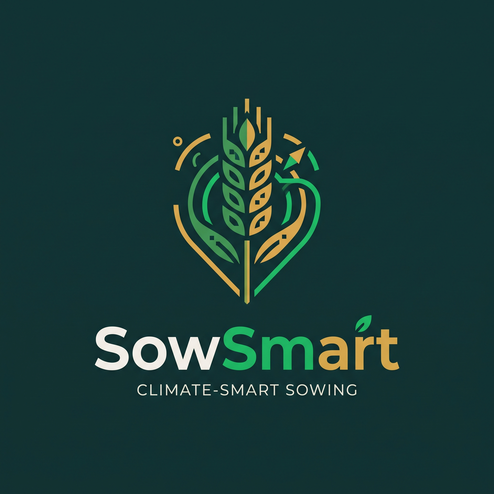
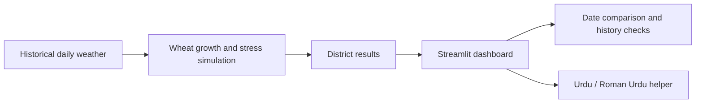

<p align="center">
  
</p>
# 🌾 SowSmart

**Find the safest day to sow wheat, using decades of local weather history.**

SowSmart helps farmers and agricultural advisors in Punjab and Sindh find the safest day to sow wheat. It replays decades of Open-Meteo weather history against different sowing dates across 8 districts, scores heat-stress risk, and explains results in Urdu and Roman Urdu. Built with Python and Streamlit.

<!-- Add a screenshot or GIF of the dashboard here, e.g.:  -->

**Links:** [Demo video](ADD_VIDEO_URL) · [Slides](ADD_PPT_URL) · [Documentation](ADD_DOCUMENTATION_URL)

**SowSmart:** [SowSmart](https://sowsmart-itsnotabug-itsafeature.streamlit.app/) 
---

## The Problem

Wheat is Pakistan's most important staple crop, and when it is sown matters. Wheat sown late can reach grain filling during hotter weather, which puts the crop under heat stress.

Today, most farmers decide their sowing date from general knowledge: what they did last year, what neighbors do, or a fixed calendar. Many also have to delay sowing because the previous crop is still in the field, and they have no way to see how much extra heat risk that delay adds.

There is no district-level tool that lets a farmer or advisor compare sowing dates for their own area. A single national calendar ignores the fact that Faisalabad, Multan and Hyderabad have different weather, and a warming, less predictable climate makes fixed dates even less reliable.

SowSmart fills this gap for the major wheat-producing districts of Punjab and Sindh, replacing guesswork with evidence from local weather history.

## Our Solution

SowSmart replays historical weather seasons against different sowing dates. For each date it estimates when the wheat would mature and gives a simple, transparent stress score.

**With the dashboard you can:**

1. **Pick a district and a sowing date** from Faisalabad, Multan, Bahawalpur, Rahim Yar Khan, Sargodha, Sahiwal, Larkana or Hyderabad.
2. **See the safest window**, the best-scoring date, and how your chosen date compares.
3. **Check the evidence:** the 2022 heat season, long-term shifts in sowing dates, and an earlier-vs-later date comparison.

### 🗣️ Urdu / Roman Urdu Helper

Most farming tools assume English. SowSmart includes a built-in helper that explains your district's results in **Urdu and Roman Urdu**, so farmers can ask questions in their own language. It works offline out of the box, and can optionally use an Anthropic, Gemini or Groq model for more conversational answers.



##Dashboard 

## Why It's Useful

- **Local:** results for each district, not one national calendar.
- **What-if:** compare any two dates instead of getting a single fixed answer.
- **Climate-aware:** the research pipeline tests warming scenarios and runs sensitivity checks.
- **Backed by data:** built on Open-Meteo historical weather, with yield-data comparison tools included.
- **Accessible:** guidance in the language farmers actually speak.

## Tech Stack

| Area | Tools |
| --- | --- |
| Language | Python 3.10+ |
| Interactive dashboard | Streamlit |
| Data processing and simulation | pandas, NumPy |
| Statistics and trend analysis | SciPy |
| Dashboard charts and maps | Plotly, Streamlit charts |
| Research charts | Matplotlib |
| Weather data and API access | Open-Meteo Archive, Forecast and Seasonal APIs; `requests` |
| Urdu / Roman Urdu helper | Offline fact-based responses, with optional Anthropic, Gemini or Groq support |
| Data formats | CSV and JSON |


## Repository Guide

| Path | What it does |
| --- | --- |
| `app.py` | Streamlit dashboard |
| `results.json` | Precomputed district results used by the dashboard |
| `sowing_model.py` | Crop growth and stress simulation |
| `advisor.py` | Batch analysis and research outputs |
| `wheat-advisor/` | Weather download, Urdu helper, yield data, calibration notes |
| `forecasts/` | Saved forecast snapshots |

## Impact and SDG Alignment

- **SDG 2: Zero Hunger** by making climate-related wheat sowing risk easier to explore.
- **SDG 13: Climate Action** by helping users examine historical heat exposure and warming scenarios.
- **SDG 9: Industry, Innovation and Infrastructure** by applying accessible data tools to a practical agricultural challenge.
- **SDG 8: Decent Work and Economic Growth** Better sowing decisions helps support more stable and productive farm work and income.

*These are the areas SowSmart is designed to contribute to, not measured impact claims or an official SDG certification.*

## Scope

SowSmart is a prototype that estimates **weather stress**, not yield, income or crop loss. It uses district-center weather for 8 irrigated-plains districts and does not model irrigation, variety or fertilizer. Past patterns are not a forecast for this season. It is a tool to support the sowing-date conversation between farmers and advisors.

## How to Run Locally

Needs Python 3.10+. No API key or data download required.

**macOS / Linux:**

```bash
python3 -m venv .venv
source .venv/bin/activate
pip install -r requirements.txt
streamlit run app.py
```

**Windows (PowerShell):**

```powershell
python -m venv .venv
.\.venv\Scripts\Activate.ps1
pip install -r requirements.txt
streamlit run app.py
```

Then open **http://localhost:8501**.

> If PowerShell blocks activation, run `.\.venv\Scripts\python.exe -m streamlit run app.py` instead.
> To test the Urdu helper offline: `python test_urdu.py simple`


## Team

Built together by [Eiman Fatima](https://github.com/eiman-fatimaa), [Arham Nabi](https://github.com/Arham-Nabi), [Maryam Amir](https://github.com/MA7865) and [Romaisa Kashif](https://github.com/Romk27).
